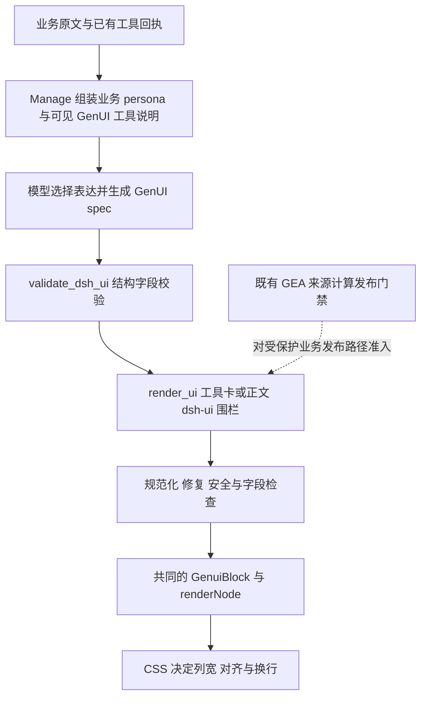

# PC 业务消息卡片布局规划与本轮复盘

状态：本方案实现与隔离本地验收已完成，结果见 [PC 卡片验收](../../tests/browser/pc-business-card-layout.ACCEPTANCE.md)。下文保留调查基线与设计取舍；托管 CI 以本次提交对应的 Actions 为准。正式客户端和官方 Core 未修改。

建议采用规整的业务消息组合。模型负责事实和表达选择；渲染器负责卡片宽度、换行与同组对齐；既有业务门禁继续控制来源、计算和发布。普通业务回复中的异质信息按阅读顺序纵向组织，同类指标才并排。保留组件能力和完整内容，不以减少必需组件、缩小字体、裁切文本或添加空内容来换取整齐。

## 1 调查基线与原有生成链路

本地仓库为 `CleverC2200/dsh-genui`，分支 `codex/genui-presentation-integration`，调查 HEAD 为 `1c4848f9b89371f5d1ef9146b5222e9c80db8ee2`。调查开始时工作区干净。没有 `.codegraph/`，本轮以当前源码、提交历史、会话记录和原验收文件核对。

当前源码与职责：

- `src/plugin/presentation-policy.ts` 决定何时组件、何时短答，要求事实范围、单位、状态与来源一致，并规定同一信息只交付一次。共享规则由系统段与两个工具说明消费。
- `src/plugin/index.ts` 注入全局 GenUI 系统段；`SKILL.md` 提供字段参考和示例。两处仍鼓励 `grid`、`span` 的 bento 混排。
- `src/plugin/tool.ts` 注册 `render_ui` 与 `validate_dsh_ui`。后者明确 `validation_scope=ui_structure_only`，无 DOM、无网络、不验算业务值。`final:true` 在结构诊断清除且宿主支持时结束本轮，并不代表视觉审查已通过。
- `src/client/guard.ts:processGenuiSpec` 统一做别名规范化、修复、安全与结构检查。它不知道实际卡宽、字体、内容行数或卡片高度。
- 工具卡经 `toolview.tsx`，正文围栏经 `fence-render.tsx`，最终均进入 `ExportableGenuiBlock` / `GenuiBlock` / `blocks/render-node.tsx`。面板和独立导出也复用 GenuiBlock；布局改动必须考虑这些调用方。
- `render-node.tsx` 按模型给出的 `grid.cols` 创建等宽列，`span` 创建跨列包装。当前没有针对“指标组”与“长说明组”的不同卡片布局合同。
- `GenuiBlock.module.css` 中 `row > card` 等高，`grid` 使用 `align-items:start` 自然高度。后者可追到 `6bf0b4d9`，当时明确为消除短卡内部被拉伸出的空白，不是偶然遗漏。
- `keyvalue` 的标签固定 120px。在本次约 297px 的卡片里，扣除内边距、标签与间隔，值只剩很窄的空间，连续标识因此被折成很多行。

隔离安装产物核对到 Manage `0.6.3-company.60`、GEA `0.0.259`。Manage 的 `mountGenuiPresentation` 使用本步可见 `render_ui` / `validate_dsh_ui` 及 `business_values` 工具说明补入 complete persona。GEA 对受保护发布有当前轮次、所有者、来源与参数准入检查。本方案复用这些职责，不在布局层复制计算或权限规则。该核对不构成重新执行业务门禁验收。

## 2 本次失败及验收失准

用户截图对应修后新生成的 `mixed` 压力例。1440 PC 实窗、约 915px 组件宽度下，三卡宽度各约 297px，高度分别约 115、220、399px。左、中卡下方留出约 285、180px 的空白。原检查的越界失败数组为空，因此旧记录给出了通过结论；它没有证明组合排版合格。

这份压力提示明确要求三张卡、保留超长标识和完整大数值，允许卡片随内容增高。该轮使用专用布局 Agent，未加载业务 preset，且只暴露两个原生 GenUI 工具。它适合检验极端内容的承载能力，不能证明正常业务提示下的表达选择或工具选择正确。

已提交的 `model-card-layout.json` 只有 row、nested-grid 两个案例，未纳入后来有效的三卡 mixed 输出。`measureCards` 检查全文、卡数、溢出与裁切，没有组合可读性条件。原浏览器检查对同组 stat 已有行底对齐断言，对非 stat grid 又明确保留自然高度。因此修复必须先区分组的职责，不能把全局所有 grid 一律改成等高。

保留原 `ACCEPTANCE-PC.md`、JSON、截图、首次只有两张实卡的无效 mixed 输出，以及启动/采集失败。原通过结论限定于当时已检查的几何与内容完整性；本轮提出的业务组合排版尚未通过。

## 3 业务消息的目标形态

下表是使用既有节点的组合约定，不是新增模型工具或新增组件类型。

| 用户任务 | 推荐表达 | 卡片布局责任 |
| --- | --- | --- |
| 只问单值、第一名或状态含义 | 原有短答 | 保留短答，不为统一样式强制出卡 |
| 状态总览、分页进度 | table / keyvalue / list，必要的范围说明与操作 | 一条主阅读流；未知和未完成保持原语义 |
| 库存或经营指标对比 | 同类 stat 指标组，加所需明细 | 同类指标可并排，同排同宽同高；原值和单位完整 |
| 排行、多对象明细 | table / 横向 chart，已有月份切换或筛选 | 不把每个对象都拆成高度不同的卡；保留名次与期间 |
| 结论、项目说明、长标识、来源与限制 | text / keyvalue / callout / copy | 长内容使用充分宽度，与指标分区，避免异质三卡平分一行 |
| 后续动作 | 既有 button / 本地控件 | 动作名、payload、权限、派发次数和回显合同保持 |

普通业务回复建议按“结论或标题 → 所问指标或状态 → 必需明细 → 范围与限制 → 必需动作”组织。缺少的部分不占空位，也不生成占位卡。一个主组件可以包含这些区域，不要求每段文字另包一张卡。

图形、流程、地图、媒体与用户明确要求的复杂交互继续使用各自节点能力。业务消息的规整原则不等于删除 GenUI 的通用能力。

## 4 推荐实施设计

### 4.1 先收敛生成约定

在既有 `GENUI_PRESENTATION_POLICY` 补充一段简短的业务组合约定，供两个工具说明与系统段共同使用：同类指标成组，长说明与明细分区；模型给出逻辑分组，实际列数与卡片几何由渲染器保障。

替换 `SKILL.md` 与系统段中将 bento 混排作为默认审美建议的措辞，保留 `cols`、`span` 等字段参考与通用能力。业务示例改用上一节的规整组合。规则留在共享源，Skill 主要给正向示例，不再复制一份完整业务管控文本。

验证真实工具说明能进入 Manage 组装后的业务提示，不能只检查全局 section 字符串。保留当前 3400 字符提示预算、业务 persona、工具定义和顺序约定。GenUI 说明的变更不需要新增 Manage 接线或改 GEA 门禁。

### 4.2 渲染器提供确定性兜底

先在既有 `render-node.tsx` 的 row/grid 分支集中处理纯卡片组，避免增加公共协议、布局服务或全局配置。分组依据节点的已知结构，不根据中文标题、业务名称、字符串关键词推断业务含义。

- 同构的紧凑指标卡可以并排。每个视觉行内同宽、顶底对齐，具体可用列数受实际内容区域和可读字号约束。模型给的列数在此类组里作为列数上限，不保证始终按该列数挤排。
- 混有说明、键值、长明细等阅读内容的卡片组，首版采用按原顺序纵向通栏的保守兜底。这样能够稳定消除本次“异质卡片平分三列”的失败，而不需要猜哪个标题更重要。
- 新生成的正常业务回复优先从结构上将概览、指标、明细分区；旧 spec 不满足这个组合时，由上述通栏规则兜底。渲染器不把旧卡里的事实抽出、重写或移动到其他逻辑节点。
- 一般文本 grid、按钮行、图表、diagram、地图与媒体的专属布局不直接套用上述卡片组规则。带表单、条件节点的组先保留阅读和焦点顺序，复用原可见性与答案状态处理。
- 对受新约束的卡片组，显式 span 必须随有效列数处理，不能因为降列又生成隐式轨道。原 JSON 的 cols/span 保留，渲染时计算展示位置；不写回业务 spec。

这个默认会改变部分历史纯卡片组的视觉排布，包括原先刻意并排的混合卡片。实施时必须将其作为明确的兼容性影响验证。若存在必须保留自由 bento 的实际公司场景，先以该场景夹具决定例外，不先引入绕过规则的模型开关。

### 4.3 修复卡内可读性

- keyvalue 标签宽度随内容与卡宽分配；空间不足时按“标签在上、值在下”呈现。短标签不再固定吞掉 120px，完整值可读。
- 普通数值 stat 沿用当前数值/文本识别，数字主体优先保持一行，单位可作为完整后缀换行。数字放不下时先增加卡宽或减少列数，而不是直接在数字中间断开。
- `2 pages remain` 等状态句继续按文本处理；原小数逗号、正负号、单位和静态大数值完整性继续受现有测试约束。
- 先验证 CSS 内在尺寸、卡片最小可读宽度与容器查询能否满足既定样例。仅当 CSS 无法确定长数字所需卡宽时，才对该指标组测量实际文本宽度并在有限列数中选择；不对整页做评分、反复测高或调用模型重排。
- 极端数字若在 PC 整行和正常字号下仍放不下，不能同时保证单行、全量静态可见和固定容器宽度。首版保留完整原值并提供局部横向查看与复制，不截小数、不改单位、不偷偷改成万/亿。此例单独标明，不能作为普通金额换行合格的理由。
- 长说明完整展示；来源与数据不足提示不因高度限制被隐藏。折叠沿用既有明确的 accordion 等表达，不以布局修复为由自动隐藏关键事实。

### 4.4 保持来源、交互和状态不变

布局只改变 DOM 的几何表达；canonical spec、业务值、原始单位、来源引用、作用范围、actions、字段 id、路径与数据顺序保持。不能在已有准入后改工具参数，也不能让响应式重排造成表单草稿丢失或 action 自动派发。

同一套渲染规则覆盖工具卡、正文围栏、面板与独立导出。动态窗口、字号、筛选、月份切换或条件变化时使用当前内容排版，沿用稳定的逻辑节点身份。DOM 顺序与键盘顺序一致。

`validate_dsh_ui` 继续报告结构校验范围。它没有真实 DOM，不增加“视觉通过”的回执；浏览器视觉证据由既有验收脚本产生，不为每次业务回复启动浏览器或增加自动重试回路。

## 5 验收方案

### 5.1 先让当前截图成为失败例

把修后有效的 mixed 三卡输出连同合成来源与必要原文加入现有布局夹具，保留最初两卡输出为单独失败记录。沿既有 `check-business-presentation-browser.mjs` 扩展，不另建框架。

先在 `1c4848f` 基线上运行新断言，确认能够拒绝本次布局。新规则应直接检查组合行为：混合阅读卡不能继续被挤成三列；普通数值在可分配宽度足够时不拆数字；键值空间不足时可切为上下布局。仅记录空白比例或高度比用于定位，不以一个全局比例阈值判断所有图表、表单和卡片好坏。

### 5.2 固定回归与真实业务生成分开

| 层次 | 输入与范围 | 通过条件 |
| --- | --- | --- |
| 纯逻辑/现有定向测试 | 受影响分组、数值识别、静态精度、字段与交互合同 | 分类确定，值和路径不改，已有兼容行为保持 |
| 固定浏览器 | row、nested-grid、有效 mixed、同类指标、原分页状态；复用必要的交互夹具 | 新布局断言、全文、无裁切/越界/重叠、状态语义与本地事件均通过 |
| PC 矩阵 | 1024/1440 窗口；既有 640/960 内容宽度；14/17/22 宿主字号 | 每个适用夹具跑完其宽度与字号组合，记录实际视口与组件宽度 |
| 同输入实窗 | 原失败 spec，在同一隔离开发客户端回放 | 实际布局符合新合同，截图可读，原值完整，不靠换输出证明修复 |
| 真实模型压力例 | 原长文本、大数值、长单位输入 | 作为承载能力验收，不冒充业务表达选择验收 |
| 正常业务提示生成 | 保留当前业务 persona 的状态、库存、排行案例 | 形式选择合理，字段、单位、范围、状态和动作正确，实际渲染与视觉规则同时通过 |
| 受影响兼容与 CI | 现有 check、公司 browser-presentation、受影响面板与导出入口 | 复用既有检查，不将本地通过称为托管 CI 或发布通过 |

真实业务生成先用已有合成原值与无生产查询的案例。保留正常工具定义和业务 persona，在执行边界阻断无关读取与写入；若案例依现有规则需要纯计算，使用已授权的既有计算能力，不重开计算门禁开发。无关工具尝试须记录，不能换 persona、隐藏失败或选择重跑结果计通过。

提示有改动时补跑既有短答与单次交付检查，确保不把“规范卡片”变成“所有问题都出卡”。本轮不重复启动完整业务门禁专项。

固定浏览器和实窗检查还应覆盖：改窗口不触发 action；原按钮每次只派发一次；月份切换仍按原本地/模型通道工作；草稿不丢；unknown、未完成、partial 不被标为全量成功。必要时只挑受本次布局改动影响的既有案例，避免重复建立交互夹具。

## 6 交付顺序与停止条件

1. **锁定合同和失败样例。** mixed 进入固定回归，新断言在当前版本失败。确定业务消息的规整排版与通用复杂图形的适用范围。
2. **完成渲染兜底。** 先处理纯卡片组、keyvalue 和数值可读性，同一旧输出通过全部 PC 布局组合。CSS 已能解决时不增加文本测量状态。
3. **收敛生成提示与例子。** 共享 policy 和示例一致，实际业务提示装配与工具说明验证通过，预算保持。
4. **验证交互与其他入口。** 工具卡、围栏、面板和独立导出使用一致规则，原 action、路径、草稿与状态语义检查通过。
5. **真实模型和独立视觉审查。** 压力例与正常业务例分开统计，逐张看真实 PC 窗口；审查者评估信息分组与可读性，机械条件交给脚本。
6. **按验收结果提交。** 所有本轮必需项通过后才提交实现。是否推送、PR、发布与正式安装继续按用户当前授权，不能由本计划自动扩大。

任一步发现缺口，保留原输入和失败证据，定位该缺口后再重跑受影响项。没有完成的内容以待验收记录；不因单元测试数量多、工具返回 rendered 或截取到组件就合并为整体通过。

## 7 Retro 改进候选，按严重程度排序

| 严重度 | 本次问题 | 对应改进及落点 |
| --- | --- | --- |
| 高 | 生成规范鼓励自由 bento，业务输出却需要稳定比较和阅读 | 共享呈现规则收敛，替换诱导性示例；逻辑不写进全局 AGENTS |
| 高 | 混合卡片失败不在固定夹具，几何通过掩盖可读性失败 | 复用现有浏览器 runner，增加具体的组合、数字和键值行为断言 |
| 高 | 通过结论覆盖了未测的组合品质 | 既有结果记录分别保留结构、内容、布局可读性、交互、实际渲染的结果；本轮必需项 pending 不算通过 |
| 中 | 专用布局 Agent 的结果被容易理解为业务回复验收 | 压力测试和实际业务提示的模型选择验收分开，保留 persona 与执行边界证明 |
| 中 | 多次大段日志、会话正文或脚本源码探针增加成本且曾超时 | 默认输出 case、实际宽度、卡数、失败项、证据路径；原始敏感材料只留隔离目录。已有样式与行为能定位时不扫描所有脚本 |
| 低 | 固定回归、私有实窗脚本和最终结论入口分散 | 在现有 browser acceptance 文档加入本轮必要入口与完成条件；不建立新全局工具平台 |

自有 `.github/workflows/company-dsh.yml` 已运行 `pnpm run check`，并调用业务浏览器 runner；本次不是“没有 CI”的问题。当前候选没有因本轮规划而推送，因此本轮没有新的托管 CI 运行结果。是否配置为分支保护必需状态未在本轮核实，不作缺失断言。

卡片高度、数字行数、布局形态属于可自动检查的行为，优先补脚本。信息是否该同组、是否保留关键业务限制属于审查判断，在现有验收说明中就近说明；不新增大篇幅全局 AGENTS 或泛化审美打分规则。该建议不包含本轮直接修改 Agent 全局环境。

## 8 证据与任务归属

- 原生成与几何验收：`worktrees/t5/.e2e-artifacts/candidate-runtime/layout-20261117/ACCEPTANCE-PC.md`，相对本仓库父目录定位；旧证据原件保留。
- 用户截图对应的有效输出：同 runtime 下 `layout-20261117-post/replay-input/mixed-r1.json`；实际卡片几何与截图见 `layout-20261117-post/native-pc1440/` 和 `native-pc1024/`。
- 原规则与实例：`SKILL.md`、`src/plugin/presentation-policy.ts`、`src/plugin/index.ts`、`src/plugin/tool.ts`。
- 真实浏览器检查：`scripts/check-business-presentation-browser.mjs`；规范与业务用例：`tests/browser/business-presentation.README.md`、`tests/fixtures/business-presentation-cases.json`。
- 已有 Issue 归属：[总规格 #2](https://github.com/CleverC2200/dsh-genui/issues/2)、[渲染器 #4](https://github.com/CleverC2200/dsh-genui/issues/4)、[提示与示例 #5](https://github.com/CleverC2200/dsh-genui/issues/5)、[验收 #7](https://github.com/CleverC2200/dsh-genui/issues/7)。本轮只读取，未更新 Issues 或 PR。

规划阶段未实施规则。后续实现已完成失败样例、正常业务生成、交互与 PC 矩阵验收，原失败和环境故障证据保留。本文记录设计与调查，实际结果以验收入口及对应提交的 Actions 为准。
